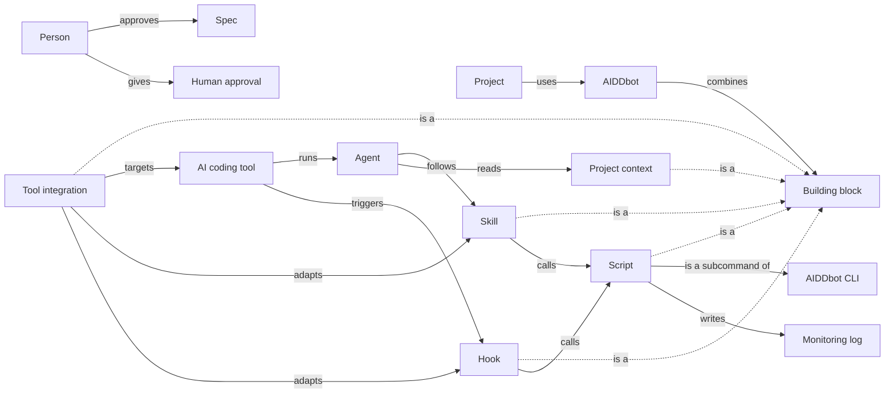
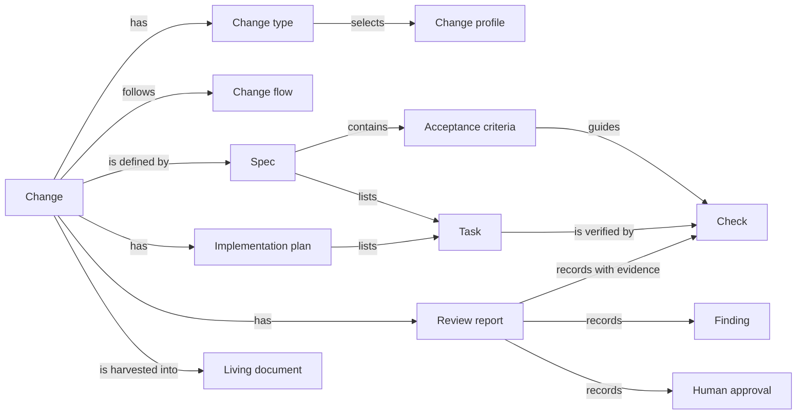
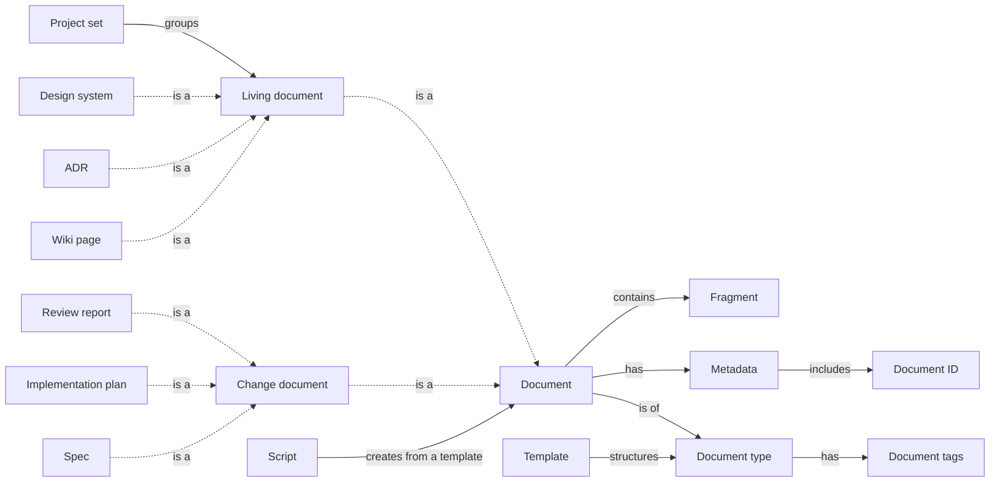
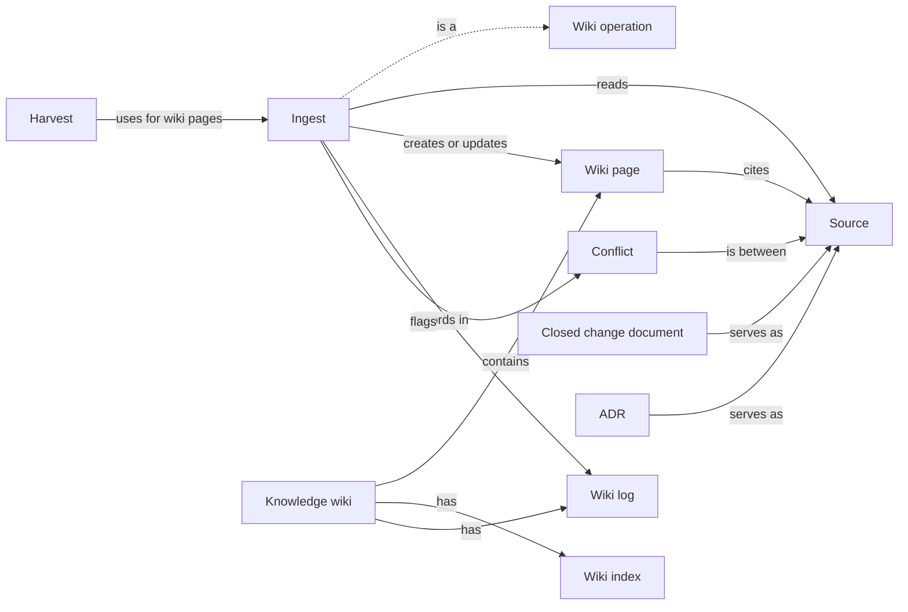

# AIDDbot Ontology

Status: **draft**. The model describes the intended system.

This is the domain model of AIDDbot. It shows the kinds of things in AIDDbot, how they relate, and the rules that always hold. The [glossary](GLOSSARY.md) defines each term. This page defines only the relationships.

## How to read this model

- Each section has a diagram and a table. The table is the text equivalent of the diagram.
- Read each row from left to right: *From* → *Relationship* → *To*.
- **Count** says how many *To* items one *From* item has: `1`, `0..1`, `*` (zero or more), or `1..*` (one or more).
- **Kinds** lists the "is a" relationships. For example, a spec is a change document.
- In the diagrams, a solid arrow is a relationship and a dashed arrow is an "is a" relationship. Counts appear only in the tables.

## People and building blocks

**Kinds.** [Skill][skill], [hook][hook], [script][script], [tool integration][tool-integration], and [project context][project-context] are [building blocks][building-block].

| From | Relationship | To | Count |
| --- | --- | --- | --- |
| [Project][project] | uses | [AIDDbot][aiddbot] | 1 |
| [AIDDbot][aiddbot] | combines | [Building block][building-block] | 1..* |
| [AI coding tool][ai-coding-tool] | runs | [Agent][agent] | 1..* |
| [AI coding tool][ai-coding-tool] | triggers, on a configured event | [Hook][hook] | * |
| [Agent][agent] | follows | [Skill][skill] | * |
| [Agent][agent] | reads | [Project context][project-context] | 1 |
| [Tool integration][tool-integration] | targets | [AI coding tool][ai-coding-tool] | 1 |
| [Tool integration][tool-integration] | adapts | [Skill][skill] and [Hook][hook] | * |
| [Skill][skill] | calls | [Script][script] | * |
| [Hook][hook] | calls | [Script][script] | 1..* |
| [Script][script] | is a subcommand of | [AIDDbot CLI][aiddbot-cli] | 1 |
| [Script][script] (`aiddbot log`) | writes | [Monitoring log][monitoring-log] | 1 |
| [Person][person] | approves | [Spec][spec] | * |
| [Person][person] | gives | [Human approval][human-approval] | * |

[Building blocks](INTENT.md#building-blocks) · [Execution from skills and hooks](SCRIPT-TOOLCHAIN.md#execution-from-skills-and-hooks)

## Changes

| From | Relationship | To | Count |
| --- | --- | --- | --- |
| [Change][change] | has | [Change type][change-type] | 1 |
| [Change type][change-type] | selects | [Change profile][change-profile] | 1 |
| [Change profile][change-profile] | sets the relevance of | [Document type][document-type] and [Fragment][fragment] | * |
| [Change][change] | follows | [Change flow][change-flow] | 1 |
| [Change][change] | is defined by | [Spec][spec] | 1 |
| [Change][change] (`epic`) | splits into | [Change][change] (`feat`), defined by a `prd` | 1..* |
| [Spec][spec] | contains, except in a `chore` | [Acceptance criteria][acceptance-criteria] | 1..* |
| [Spec][spec] (`chore`, `refactor`, `fix`) | lists | [Task][task] | 1..* |
| [Change][change] (`feat`, `epic`) | has | [Implementation plan][implementation-plan] | 1 |
| [Implementation plan][implementation-plan] | lists | [Task][task] | 1..* |
| [Task][task] | is verified by | [Check][check] | 1..* |
| [Acceptance criteria][acceptance-criteria] | guide | [Check][check] | 1..* |
| [Change][change] | has | [Review report][review-report] | 1 |
| [Review report][review-report] | records the results of | [Check][check], with [Evidence][evidence] | 1..* |
| [Review report][review-report] | records | [Finding][finding] and [Human approval][human-approval] | * |
| [Change][change] | is harvested into, when it closes | [Living document][living-document] | * |

The [change profile](DOCUMENTATION-CATALOG.md#change-profiles) gives the exact rules for each change type. The context of a change (`ui`, `api`, `data`…) adds documents and fragments.

## Documents

**Kinds.**

- [Change documents][change-document] (`CHG`): [spec][spec], [implementation plan][implementation-plan], and [review report][review-report].
- [Living documents][living-document] (`LIVE`): [wiki page][wiki-page], [ADR][adr], and [design system][design-system].
- Both are [documents][document]. The catalog gives the life of every other document type.

| From | Relationship | To | Count |
| --- | --- | --- | --- |
| [Document][document] | is of | [Document type][document-type] | 1 |
| [Document type][document-type] | has | [Document tags][document-tags] | 1 |
| [Template][template] | structures | [Document type][document-type] | 1 |
| [Script][script] (`aiddbot doc new`) | creates from a template | [Document][document] | 1 |
| [Document][document] | has | [Metadata][metadata] | 1 |
| [Metadata][metadata] | includes | [Document ID][document-id] | 1 |
| [Document][document] | contains | [Fragment][fragment] | * |
| [Project set][project-set] | groups | [Living document][living-document] | 5 |

[Document catalog](DOCUMENTATION-CATALOG.md#document-catalog) · [Metadata](DOCUMENTATION-CATALOG.md#metadata-meta)

## Knowledge

**Kinds.** [Ingest][ingest], answer, and wiki review are [wiki operations][wiki-operation]. A [source][source] can be a closed [change document][change-document], an [ADR][adr], a raw file in `docs/raw/`, or an external URL.

| From | Relationship | To | Count |
| --- | --- | --- | --- |
| [Knowledge wiki][knowledge-wiki] | contains | [Wiki page][wiki-page] | * |
| [Knowledge wiki][knowledge-wiki] | has | [Wiki index][wiki-index] and [Wiki log][wiki-log] | 1 each |
| [Wiki page][wiki-page] | cites, with a [citation][citation] | [Source][source] | 1..* |
| [Harvest][harvest] | uses, for wiki pages | [Ingest][ingest] | 1 |
| [Ingest][ingest] | reads | [Source][source] | 1 |
| [Ingest][ingest] | creates or updates | [Wiki page][wiki-page] | 1..* |
| [Ingest][ingest] | records an entry in | [Wiki log][wiki-log] | 1 |
| [Ingest][ingest] | flags | [Conflict][conflict] | * |
| [Conflict][conflict] | is between | [Source][source] | 2..* |

[Wiki model](KNOWLEDGE-WIKI.md#model) · [Operations](KNOWLEDGE-WIKI.md#operations)

## Invariants

Rules that always hold. A skill or a script can check each one.

1. **One fact, one home.** A fact lives in one document. Other documents link to it. ([Wiki model](KNOWLEDGE-WIKI.md#model))
2. **Spec first.** A change has an approved spec before any code. ([Principles](DOCUMENTATION-CATALOG.md#principles))
3. **Frozen change documents.** When a change closes, its change documents get status `done`. Nobody edits them after that. ([Life](DOCUMENTATION-CATALOG.md#3-life))
4. **Superseded, never edited.** A new ADR supersedes an old one. Nobody edits an accepted ADR. ([Design](DOCUMENTATION-CATALOG.md#p2--design))
5. **Cited claims.** Every claim on a wiki page cites a source, or it is marked `(unverified)`. ([Page rules](KNOWLEDGE-WIKI.md#page-rules))
6. **Unique IDs.** A document ID is never reused. ([Metadata](DOCUMENTATION-CATALOG.md#metadata-meta))
7. **Immutable raw sources.** Files in `docs/raw/` are added, never edited or deleted. ([Sources](KNOWLEDGE-WIKI.md#sources))
8. **A person decides.** Conflicts and the decisions marked for human approval need a person. ([Inclusion criteria](INTENT.md#inclusion-criteria))

## Change history

- v4. Use the portable Mermaid subset from [DESIGN.md](DESIGN.md#mermaid-diagrams): `graph` diagrams, with counts only in the tables.
- v3. Add "is a" relationships, counts, invariants, and Mermaid diagrams. Fix tasks in specs, `epic` changes, the CLI relationship, and the kinds of source. Add change closing, templates, metadata, findings, and human approval. Move the explorer uses to the explorer document. Add `META` frontmatter.
- v2. Remove the illustrative business change and keep the model at the concept level.
- v1. Record how the glossary concepts relate and propose their first uses in the explorer.

[acceptance-criteria]: GLOSSARY.md#acceptance-criteria
[adr]: GLOSSARY.md#adr
[agent]: GLOSSARY.md#agent
[ai-coding-tool]: GLOSSARY.md#ai-coding-tool
[aiddbot]: GLOSSARY.md#aiddbot
[aiddbot-cli]: GLOSSARY.md#aiddbot-cli
[building-block]: GLOSSARY.md#building-block
[change]: GLOSSARY.md#change
[change-document]: GLOSSARY.md#change-document
[change-flow]: GLOSSARY.md#change-flow
[change-profile]: GLOSSARY.md#change-profile
[change-type]: GLOSSARY.md#change-type
[check]: GLOSSARY.md#check
[citation]: GLOSSARY.md#citation
[conflict]: GLOSSARY.md#conflict
[design-system]: GLOSSARY.md#design-system
[document]: GLOSSARY.md#document
[document-id]: GLOSSARY.md#document-id
[document-tags]: GLOSSARY.md#document-tags
[document-type]: GLOSSARY.md#document-type
[evidence]: GLOSSARY.md#evidence
[finding]: GLOSSARY.md#finding
[fragment]: GLOSSARY.md#fragment
[harvest]: GLOSSARY.md#harvest
[hook]: GLOSSARY.md#hook
[human-approval]: GLOSSARY.md#human-approval
[implementation-plan]: GLOSSARY.md#implementation-plan
[ingest]: GLOSSARY.md#ingest
[knowledge-wiki]: GLOSSARY.md#knowledge-wiki
[living-document]: GLOSSARY.md#living-document
[metadata]: GLOSSARY.md#metadata
[monitoring-log]: GLOSSARY.md#monitoring-log
[person]: GLOSSARY.md#person
[project]: GLOSSARY.md#project
[project-context]: GLOSSARY.md#project-context
[project-set]: GLOSSARY.md#project-set
[review-report]: GLOSSARY.md#review-report
[script]: GLOSSARY.md#script
[skill]: GLOSSARY.md#skill
[source]: GLOSSARY.md#source
[spec]: GLOSSARY.md#spec
[task]: GLOSSARY.md#task
[template]: GLOSSARY.md#template
[tool-integration]: GLOSSARY.md#tool-integration
[wiki-index]: GLOSSARY.md#wiki-index
[wiki-log]: GLOSSARY.md#wiki-log
[wiki-operation]: GLOSSARY.md#wiki-operation
[wiki-page]: GLOSSARY.md#wiki-page
