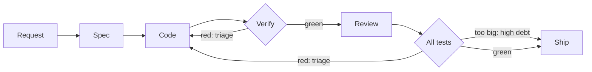

# Features

Deliver one spec at a time. Only one spec is open at a time. Each spec has its own branch.

Each step checks only its own work: fewer tests, and each failure near its cause. Only the ship tests the full system. The type of the spec sets the steps: a `chore` has no verification, and a `refactor` has no verification and no review.

## Definition

The Architect turns one request into one spec.

- A spec has a type: `feat`, `fix`, `refactor` or `chore`. A request makes a `feat`, a `fix` or a `chore`. Debt makes a `fix` (high) or a `refactor` (medium): the core writes that minimal spec from the debt item.
- A spec has three parts: the problem (user stories, business rules, what is out of context), the solution (a short list of what to do in each project), and the verification (the requirements and the expected URLs and APIs).
- Its requirements are in EARS: `R01`, `R02`, … Other records cite them as `S0042-R03`.
- A spec looks forward. It does not list shipped requirements.
- A spec declares each change to the [schemas](../principles/data.md#schemas) and each endpoint.
- The human approves the spec before the code starts. In YOLO mode, the spec is approved when it is written, and it contains only what the request names. The approval commits the spec.

## Coding

The Builder implements the spec in each project that changes.

- Implement the projects from the lower abstraction to the higher.
- Write a plan before the first edit: the units to change, in order.
- Write the code and its unit tests. Write the necessary acceptance tests in the `e2e` project.
- Each requirement has at least one acceptance test with its identifier.
- Prefer small commits of one coherent unit of work, about 16 files each, and of one type each: code, tests or docs.
- Run the unit tests of the changed files during the work. The pre-commit hook of the technology lints and formats each commit. When it refuses, fix the errors and commit again.
- In a `refactor`, run the check that found the debt, and make it pass.
- Check the acceptance tests of the spec only. Never run the full suites: that is the work of the Craftsman.

## Verification

The Craftsman proves the work. It is a different agent from the Builder.

- First verify the behavior of a `feat` or a `fix`: run the acceptance tests of the spec. Only one run operates at a time.
- Then review the implementation. The review checks only what lint and the tests cannot see. A failure of security, accessibility, the project rules or the schema impact makes the review red. Data integrity and performance are debt checks. Style, layers and complexity are not part of the review.
- A red verification goes back to the Builder. Stop only for a product question or for acceptance tests that cannot run.
- A review finding does not block. It becomes `high` debt. A security finding gets one repair.
- The ship runs the regression: all the unit tests and the full acceptance suite. A failure goes to triage. Find its cause and its owner: the code of the spec or the test goes to the Builder, a contradiction with a shipped requirement or a product question goes to the human. A failure that is too big for the spec becomes `high` debt, and the spec closes.
- At revision 3, a red verification does not block. Its failures become `high` debt.
- Ship the spec when the regression is green, or when `high` debt records each failure. Shipping updates the schemas, and releases the next version: a `feat` adds a minor version, any other type a patch, and a breaking change a major version.

Skill: [`/build-requested-spec`](../../.agents/skills/build-requested-spec/SKILL.md).

---

← [Foundation](./foundation.md) · [Engineering](./README.md) · [Future](./future.md) →
