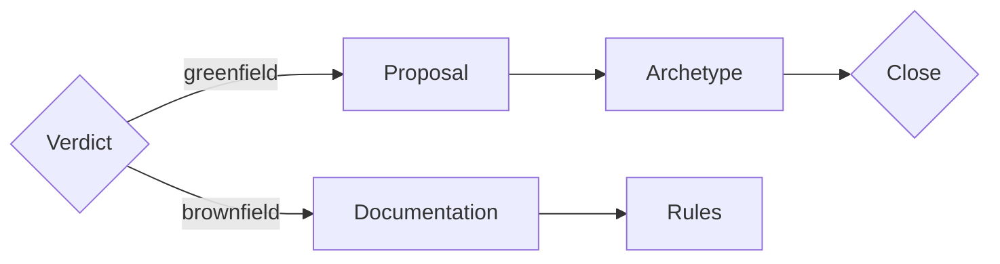

# Foundation

Start the system before you deliver business value. First, the orchestrator gives a verdict from the working code only: greenfield or brownfield. The route depends on it.

## Greenfield

The repository has no application code. Make the system from scratch.

- An approved proposal in `.product/system.md` comes first. It sets the typed [projects](../principles/project.md) of the [system](../principles/system.md). Do not write code before the approval.
- The system starts from one archetype of the catalog, such as Archetype Base or Archetype CLI: a whole solution, copied as a whole. AIDDbot offers only the archetypes of its catalog: when no archetype fits the system, the Architect says so and stops.
- The root `AGENTS.md` gets the Blueprint: the architecture and the general coding rules. Each project gets a short `AGENTS.md` with only its own data and rules.
- The foundation specs come before the business specs. The archetype brings the code, the tests, the tooling, the spec instances and the schemas. Nothing is delivered again: the instances stay in `.product/archetypes/foundation/` as the contract, and the close is the only evidence. The system keeps version `0.1.0`, and the first business spec gets the ID after the last instance.
- The Architect documents the system: only the root `AGENTS.md`, because the archetype brings the rest. Then the branch merges.
- The foundation is complete only when `test` passes. A red close is a defect of the environment or of the archetype: repair it there, never in the system. No spec starts on a red foundation.

## Brownfield

The repository has existing code. Learn the system that exists.

- Document the code. Do not change it.
- Record the rules and classify the commands of each project.
- Do not run the tests or the `debt:*` checks. Do not record debt.

## Tracking

The records tell the state of the development. The installation creates the counters and the journal; the core creates the others when it first needs them; a release writes the PRD. The tools write them. Do not write them by hand.

| Record | What it tells | Who reads it |
| --- | --- | --- |
| Journal | The story of the process: each step, each decision and its time. | Humans. No code reads it. |
| PRD | The product view: one line for each shipped `feat` spec, by domain. | Humans. |
| Debt | The open technical debt, with its priority, evidence and origin. | The repairs of the [future](./future.md). |

- The journal is only a story. Do not make a decision from it.
- A release writes the PRD. A `fix`, a `refactor` or a `chore` does not add a line.
- Each change to the debt is a commit. A repaired item goes away.

Skill: [`/architect-system-foundation`](../../.agents/skills/architect-system-foundation/SKILL.md).

---

[Engineering](./README.md) · [Features](./features.md) →
