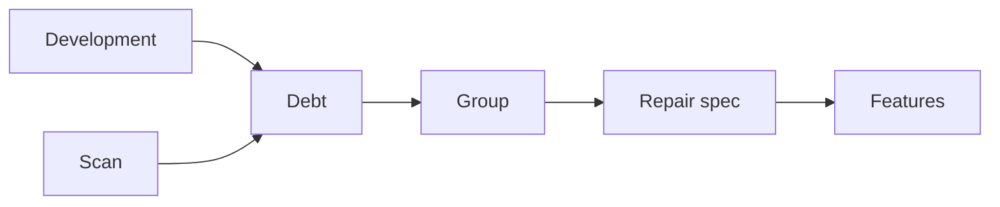

# Future

Keep the system easy to change. Pay the debt.

## Sources of debt

Debt comes from two sources:

- **Development.** A finding that does not block a delivery becomes debt. Examples: a review finding, or a failure at revision 3 of a [feature](./features.md#verification). Its origin is the spec. Its priority is `high` when it breaks (a blocking review finding, a failure), else `low`.
- **Scan.** The `quality` check measures the code. Its origin is `scan`, and its priority is `medium`.
  - Complexity over the [limits](../principles/complexity.md#limits).
  - Folders with too many entries, and subfolders in a feature.
  - Duplicated blocks of code (DRY): the repair moves each block to one function.

Record each debt with its priority, its evidence and its origin. Do not hide it. Scan from time to time, not after each spec, and only when no `medium` debt is open: a scan would find that debt again.

## Payment

1. Scan, only when no `medium` debt is open. The priority of the debt tells its source:
   - `high`: it breaks the behavior, the security or the data. A blocking review finding, or a failure.
   - `medium`: it makes a change slow or difficult. A scan finding.
   - `low`: all other debt. A debt finding of a review.
2. Select the debt of one type in one group: `fix` for each item that breaks the behavior, `refactor` for all others.
3. Make a repair spec for the group.
4. Send the spec through the normal [features](./features.md) flow. The repair needs no approval: the debt is already recorded.
5. Repeat from step 2 while debt remains, `high` first, then `medium`, then `low`, for at most five specs in one run. Do not scan between two repairs, and do not scan at the end: skip an item that an earlier repair removed. The review of each repair records the debt that the repair leaves, and the next scan finds the rest.

- A repair is a [craft pass](../principles/glossary.md). It keeps the behavior, except a `fix` for debt that breaks it.
- An upgrade of the dependencies skips the scan: it is a `chore` that repairs all that the upgrade breaks.
- A repaired item goes away from the debt.

Skill: [`/craft-lasting-quality`](../../.agents/skills/craft-lasting-quality/SKILL.md).

---

← [Features](./features.md) · [Engineering](./README.md)
