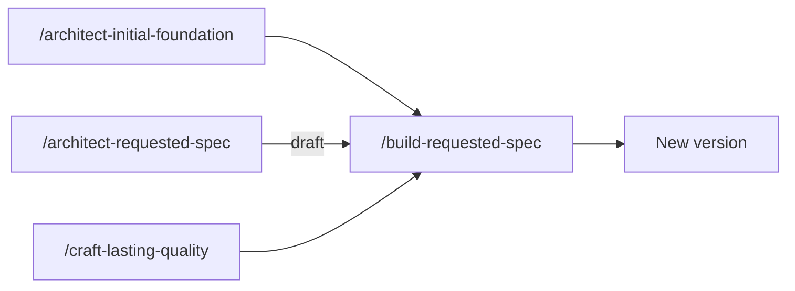
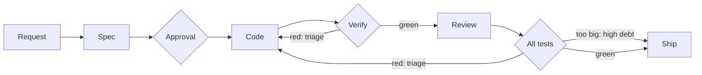

# How it works

This page gives the model of AIDDbot. For the first session, read [Getting started](./getting-started.md). For all the rules, read the [AIDD workflow](./AIDD.workflow.md).

## The idea

- **Spec first.** Each change starts as a small spec with numbered requirements. You approve it before the code starts.
- **Evidence, not trust.** Each requirement has an acceptance test. A spec ships only when its tests and the full regression pass, or with its failures recorded as debt.
- **Small surface first.** Each step checks only its own work. The Builder tests only the files that it changed, and the verification only the tests of the spec. Only the ship tests the full system.
- **The code is the truth.** A shipped spec is a record of the change. It is never written again.
- **Models judge, code checks.** The models do the non-deterministic work: design, specs, code and review. A deterministic program, the core, runs the tests, records the results and enforces the rules. It is more reliable, faster and cheaper than a model for that work.

## Three agents

| Agent | Work |
| --- | --- |
| **Architect** | Designs the system and writes the specs. |
| **Builder** | Writes the code and the tests. |
| **Craftsman** | Verifies the spec, reviews the code, runs the regression, ships the spec, and scans the quality. |

Each agent starts with a fresh context, and it reads only the skill of its step. The Craftsman is never the Builder: a different agent checks the work.

## Three commands

You start one of three commands. Each command starts the agents and the steps that it needs. The other skills in `.agents/skills/` are those steps. A fourth command, `/architect-requested-spec`, defines a spec now for a later build.

### Prepare the system

`/architect-initial-foundation` first decides the route. A repository with application code is **brownfield**, also when it is legacy code. A repository without application code is **greenfield**.

- **Brownfield.** The Architect reads the code and writes the documentation: the `AGENTS.md` of the system and of each project, the schemas, and the commands of each project. It does not change the code or run the tests.
- **Greenfield.** The Architect asks about your product and proposes the system: a set of typed projects, such as `api`, `web`, `cli` and `e2e`. The projects come from an archetype, such as Archetype Base or Archetype CLI: a whole solution that already has the foundation and its tests. If no archetype fits your system, the Architect tells you and stops. After your approval, it copies the archetype. The foundation ends only when `test` passes.

After the first run, each system is the same: a documented system with its rules. Thus `/build-requested-spec` and `/craft-lasting-quality` operate the same way on greenfield and brownfield code. Run the command again when the documentation must agree with the code.

### Deliver a change

`/build-requested-spec` takes one request in natural language.

1. The Architect writes one spec on its own branch, and stops for your approval.
2. The Builder writes the code, the unit tests and the acceptance tests, one project at a time. It tests only the files that it changes. The pre-commit hook of the technology lints and formats each commit.
3. The Craftsman runs the acceptance tests of the spec. A red result goes back to the Builder.
4. The Craftsman reviews the code for security, data integrity and accessibility: only what lint and the tests cannot see. A finding becomes `high` debt.
5. Before the release, the Craftsman runs all the tests: the regression. It triages each failure, with its cause and its owner. The Builder repairs what belongs to the spec. A failure that is too big for the spec becomes `high` debt, and the spec closes. At the third revision of the verification, the failures become debt and the spec continues.
6. Shipping merges the branch, writes `CHANGELOG.md` and `.product/PRD.md`, and tags the version: `feat` increases the minor version, other types the patch version.

To keep a backlog, run `/architect-requested-spec` with a request. The Architect writes the spec as a draft in `.product/drafts/`, and stops for your approval. A draft has no ID and no branch, so it blocks nothing. Later, `/build-requested-spec` takes the draft, skips step 1, and continues from step 2.

Only one spec is open at a time. With `YOLO` in the request, the spec is approved when it is written, and it contains only what the request names.

### Repair debt

`/craft-lasting-quality` keeps the code easy to change.

It repairs the debt from high to low. The level of the debt sets the repair:

1. Each `high` item gets a minimal `fix` spec from the core. You approve the item, then `/build-requested-spec` builds, verifies, reviews and ships it.
2. When no `high` debt is open, the Craftsman runs the `layers` checks: the logical layers, large folders and duplicated code. Each problem becomes `medium` debt.
3. The `medium` items of each project get one minimal `refactor` spec from the core, with no approval. The Builder makes the check pass, and the ship proves that the behavior did not change.
4. When no `high` or `medium` debt remains, the Craftsman runs `crap` one time: the complexity limits and the test coverage. Each rule becomes one `low` item.
5. Each `low` item is a patch: no spec and no release. The Builder makes the check pass, and the hook runs the affected unit tests.

The loop repeats while debt remains, for at most five specs. The debt comes from two places. The review and the triage of each spec add `high` debt. The scan adds `medium` debt, and `crap` adds `low` debt. A feature can ship with quality warnings. Scan from time to time, not after each spec: at most one scan runs in each `/craft-lasting-quality`, at its start.

## The core guards the process

The agents call the core, `node .agents/aidd/aidd.mjs`, at each step that changes the state. It runs the tests, records the evidence, and refuses each step that breaks a rule. Thus a model that forgets a step cannot ship. You never run it by hand.

Read [The core](./core.md) for the details.

## Where to look

| Where | What |
| --- | --- |
| `.aiddbot/logs/` | One folder for each day, with its log and the output of each failed run. Each line of the log is one step, with its time and result. Git ignores it. |
| `.product/system.md` | The approved system proposal. |
| `.product/specs/` | One file for each spec, with its requirements, in a folder for each type. |
| `.product/PRD.md` | The shipped features, by domain. |
| `.aiddbot/debt.json` | The open debt. |
| `.product/model/` | The schemas of the data and the API. |
| `AGENTS.md` | The architecture and the rules of the system. Each project has its own `AGENTS.md`. |
| `.aiddbot/config.json` | The projects and their commands. |

The records use your language. The code, the tests and the user interface use English, unless you ask for a different language.

## Learn more

- [The core](./core.md): the guards, the files and the commands of the process.
- [AIDD workflow](./AIDD.workflow.md): the skills, the evidence and the records, in detail.
- [Engineering principles](./engineering/README.md): how the development is managed.
- [Principles](./principles/README.md): the architecture and the code.
- [Customize agent profiles](./agent-customization.md): select the models and the effort.
