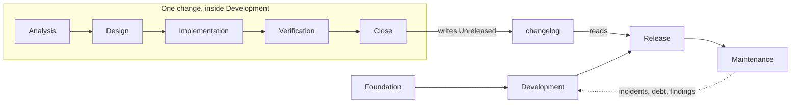

# s0003 - Separate the project loop and the change loop

## Problem

### Goal

The lifecycle model mixes two levels of work. The [lifecycle phases](../../intent.md#lifecycle-phases) table has seven phases. Four of them (Analysis, Design, Implementation, Verification) are also steps of the [change flow](../../../process/documentation-catalog.md#change-flow). The explorer map shows the same four names twice, in two rows.

The map has three more problems:

- An arrow goes from Verification to Release. It says that every change makes a release. In fact, many changes close before one release.
- The document columns mix project documents (`roadmap`, `adr`) with change documents (`spec`, `impl-plan`).
- Close and Release look unrelated. In fact, Close fills the `Unreleased` section of the `changelog`, and Release reads it.

This change applies the brainstorm proposals P1 to P9 in the Pending section of [intent.md](../../intent.md#decisions): a project loop with four phases, a change loop with five steps, and a knowledge shelf between them.

### Out of scope

- Skills, templates, and scripts for Release and Maintenance.
- New document types for Maintenance, such as incidents or technical debt.
- A new layout for the building blocks band. It stays as it is.
- Changes to the element page diagrams of steps, blocks, and document types.

### User stories

- `US1` - As a person who learns AIDDbot, I want the map to show the project loop and the change loop apart, with the knowledge shelf between them, so that I see each phase and step once and how closed changes reach a release.
- `US2` - As a person who edits the wiki, I want the lifecycle model and the document catalog to hold the new model in their tables, so that the explorer and the future skills read one model from one place.

## Solution

### The model



Text equivalent: the project has four phases: Foundation, Development, Release, and Maintenance. Maintenance feeds new changes back to Development. Development holds the changes. Each change has five steps: Analysis, Design, Implementation, Verification, and Close. Close writes to the `Unreleased` section of the `changelog`. Release reads the `changelog` and makes a version.

- A **phase** is project level. A **step** is change level. Each name is used once.
- The **knowledge shelf** holds the `LIVE` project documents. Foundation creates the first ones. Each change reads them in Analysis and Design. Close updates them.

### Wiki changes

| Page | Change | Proposal |
| --- | --- | --- |
| `intent.md` | The lifecycle phases table gets four rows and the columns `#`, `Phase`, `Work`, `Uses`, `Produces`. The Development row links to the change flow and lists no documents. The notes below the table follow the new model. | P1, P4, P5 |
| `intent.md` | The decisions table replaces decisions 1 and 3, and adds the decisions of P1 to P9. The Pending section goes away. | All |
| `documentation-catalog.md` | The Tags section adds a third tag, Form: `DOC` (text for people and agents) and `CODE` (source code and tests that tools run). The document catalog adds a `Form` column after `Life`. | P7 |
| `documentation-catalog.md` | The change flow intro no longer says that its steps use the names of the phases. It says that the change flow is the work of the Development phase. Close a change says that the `changelog` entry goes to `Unreleased`. | P2, P4 |
| `glossary.md` | New term: Development. Changed terms: lifecycle phase, project level, change level, close. New term: knowledge shelf. | P3, P4 |
| `explorer-development.md` | The wiki contract gets the new columns of two tables. The map rules describe the two loops and the shelf. | P1, P5, P6, P8 |
| Other pages | The pages that name seven phases or the `Project level` and `Change level` columns follow the new model: `README.md`, `AGENTS.md`, `PLAN.md`, `scaffolding.md`, `index.md`. | P4 |

### Builder changes

- **Phases table.** The builder reads the new columns. The ID columns are now `Uses` and `Produces`, as in the change flow table. The same code reads both tables.
- **Form.** The builder reads the `Form` column of the catalog. An unknown value stops the build.
- **Steps and phases.** A step no longer links to a phase with the same name. All steps link to the phase whose row links to the change flow: Development. No phase name is written in the code.
- **Shelf.** The shelf holds every document type with `LIVE` and `DOC`, in catalog order. No document ID is written in the code.

### The map

```text
PROJECT    Foundation ──► Development ──► Release ──► Maintenance
                              ▲    │ zoom     ▲            │
                              └────┼──────────┼── feedback ┘
                                   │          │ reads
SHELF     │ readme  glossary  wiki-page  roadmap  adr  ...  changelog │
                                   │          ▲ writes
CHANGE     Analysis ► Design ► Implementation ► Verification ► Close
           spec       impl-plan code             test-report
                      feature-file unit-test     review-report
```

Map rules:

- **Project loop.** The phases form the top row, in table order. A dashed arrow goes from the last phase to the phase that holds the change flow.
- **Change loop.** The steps form the bottom row, in table order, inside a frame. A zoom line goes from Development to the frame.
- **Shelf.** The shelf is a band between the two loops.
- **Document types.** A shelf document type sits only on the shelf. Any other document type hangs under the first step that produces it, or else under the first step that uses it.
- **Links to the shelf.** The map always draws the links between the phases and the shelf, and the links from Close to the shelf. For example, Close writes the `changelog` and Release reads it. The links of the other steps show when a person points at the step.
- **Phase page.** The phase diagram shows `Uses` and `Produces`, as the step diagram does. The Development page also lists the five steps.

### Tasks

- [x] Change the wiki tables and pages, as the [wiki changes](#wiki-changes) say. Check: `US2R1`, `US2R2`, and no broken link.
- [x] Change the builder: phases table, Form, steps and phases, shelf, with unit tests. Check: `US2R3`, `bun test`.
- [x] Change the map layout and the phase diagram. Check: `US1R1` to `US1R5`.
- [x] Run `bunx tsc --noEmit` and `bun test`. Check: both pass.
- [x] Update `CHANGELOG.md` and `PLAN.md`. Check: no broken link.
- [x] Check each requirement and tick it. Write the review report only if a requirement fails or there are findings.

## Verification

- [x] `US1R1` - When a person opens the map, the explorer shall show the phases of the lifecycle phases table in one row, in table order, with a dashed feedback arrow from the last phase to the phase that holds the change flow.
- [x] `US1R2` - When a person opens the map, the explorer shall show the steps of the change flow table in one framed row, in table order, linked to the phase that holds the change flow, and shall show each phase and step name once.
- [x] `US1R3` - When a person opens the map, the explorer shall show a knowledge shelf with every document type with `LIVE` life and `DOC` form, in catalog order, and no other document type.
- [x] `US1R4` - When a person opens the map, the explorer shall draw the links between the phases and the shelf documents, and the links from the last step to the shelf documents.
- [x] `US1R5` - When a person opens the page of a phase, the explorer shall show its `Uses` and `Produces` documents, and, for the phase that holds the change flow, its steps.
- [x] `US2R1` - The lifecycle phases table shall have the columns `#`, `Phase`, `Work`, `Uses`, and `Produces`, and the rows Foundation, Development, Release, and Maintenance.
- [x] `US2R2` - The document catalog shall have a `Form` column after `Life`, with `DOC` or `CODE` in each row, and the Tags section shall define Form.
- [x] `US2R3` - If the `Form` column is missing, or a row holds a Form value that the Tags section does not define, then the build shall stop with an error that names the file and the problem.
