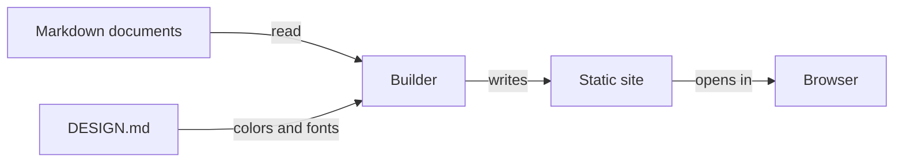

# s0002 - Build the web knowledge explorer

## Pending

> **Proposals from the brainstorm of 2026-11-25.** The spec went back to `draft` before any code was written. The sections below this one are the old version. Rewrite them with these decisions, then approve the spec again. Delete this section when the spec is rewritten.

### Decisions

| # | Decision | Reason |
| --- | --- | --- |
| 1 | `s0002` goes back to `draft` and is rewritten. | No code exists yet. The scope must change. |
| 2 | New catalog rule: an accepted spec can go back to `draft` only before its implementation starts. | The catalog does not cover this case today (decision 31 forbids other changes). |
| 3 | The core is a visual story of AIDDbot for people. It is not a graph viewer and not a copy of Obsidian. | The goal is documentation for people, as visual as possible. |
| 4 | Chapters: lifecycle phases, change flow, building blocks, and documents. | Together they show the whole picture of AIDDbot. |
| 5 | The home page is an interactive map. Each element (phase, step, block, document type) has its own page. Each page shows a mini-map or breadcrumb, so a person never gets lost. | No single huge HTML page. Detail lives on its own page. |
| 6 | The page content is built from the wiki (`intent.md`, the catalog, the glossary). The site adds only layout and animation. | The wiki stays the single source of truth. |
| 7 | Full documents are a second level: a map page links to the rendered document with its `META` badges. The map replaces the list of all documents on the home page. | Detail for people who want it. |
| 8 | Animations are SVG diagrams that build up step by step. Nothing moves while the browser asks for reduced motion. | Very visual, and easy to keep in step with the wiki. |

Removed from the old version: the graph view (`US3`) and the `d3-force` library.

#### Wiki structure for the builder

| # | Decision | Reason |
| --- | --- | --- |
| 9 | The builder finds each chapter by a fixed anchor and reads the first table under it, with fixed column names. A renamed anchor or column fails the build with a clear error. | Almost no change to the wiki. No tool-specific markers. |
| 10 | Chapter sources: `intent.md#lifecycle-phases`, `documentation-catalog.md#change-flow`, `intent.md#building-blocks`, `documentation-catalog.md#document-catalog`. | These sections already hold the four chapters. |
| 11 | The change flow becomes a table: `#`, `Step`, `Work`, `Produces` (document IDs). | The same contract for the four chapters. `Produces` links steps to documents. |
| 12 | The building blocks table adds Templates and Wiki, and a new column that lists the phases or documents that each block touches. "Project knowledge" keeps its detail sections, linked from the rows. | The map shows all the blocks, and each block links to the rest. |
| 13 | Cross-links: a document ID in backticks links to that document. A step name equal to a phase name links them. An unknown ID fails the build. | Short tables, explicit links, and early errors. |
| 14 | An element page shows its row as a summary, plus the wiki sections and glossary terms that the row links to. | Detail without new text. The wiki stays the source. |
| 15 | The contract goes in the page rules of `knowledge-wiki.md`: these anchors and columns are stable, and a change to them needs an explorer update. The detail goes in `explorer-development.md`. | A wiki editor sees the rule before they break it. |

### Open questions

- How the map looks: one picture for all chapters, or one picture per chapter.
- Which libraries stay. `marked` and `mermaid` are probable.
- Finding: `bun lint` does not exist in Bun 1.4.5 (`Script not found "lint"`). It runs a `lint` script of `package.json`. The built-in linter of [the Bun docs](https://bun.com/docs/lint) is not in the stable version yet. The project owner handles lint and format.

## Problem

### Goal

The AIDDbot knowledge lives in Markdown files: the wiki, the root documents, and the specs. GitHub and Obsidian show them as plain pages. A person cannot see the whole picture: the lifecycle phases, the links between documents, and the status of each one.

This change builds a web explorer for people. It reads the AIDDbot documents and shows them as a visual site, with navigation, graphics, and animations. It is part of the Foundation phase: it makes the project knowledge easy to read before we design the skills and templates. [Lifecycle phases](../wiki/intent.md#lifecycle-phases)

### Out of scope

- Publication to a public host, such as GitHub Pages.
- Search, editing, comments, and authentication.
- Reuse for the wiki of other projects, and any change to [what ships](../wiki/scaffolding.md#what-ships). A later spec can do it.
- Validation of documents. The `doc validate` command of H3 does it. The explorer only shows the problems that it finds while it reads.

### User stories

- `US1` - As a person who learns AIDDbot, I want to browse all the project documents from one home page, so that I find any topic quickly.
- `US2` - As a person who reads a document, I want to see it rendered with its metadata, diagrams, and working links, so that I read it as easily as a web page.
- `US3` - As a person who studies the project, I want to see a graph of the documents and their links, so that I understand how the knowledge connects.

## Solution

### How it works

The explorer has two parts: a **builder** that reads the documents, and a **site** that shows them in the browser.

Text equivalent: the builder reads the Markdown documents and `DESIGN.md`, and writes a static site. A person opens the site in a browser.

1. **The builder** runs on the person's machine with Bun. It reads each document in the content scope, its `META` frontmatter, and its links. It writes one data file with the documents, their groups, and their links, and copies the site files next to it. It lists each problem that it finds: a missing file, invalid `META`, or a broken link.
2. **The site** is a set of HTML, CSS, and JavaScript files. It works on any static file server, also in a subfolder, because all its paths are relative. It loads the data file and shows the view that the address asks for.

### Content

| Group | Files |
| --- | --- |
| Wiki | `docs/wiki/*.md`, with the groups of `index.md` |
| Root | `README.md`, `AGENTS.md`, `PLAN.md`, `DESIGN.md`, `CHANGELOG.md` |
| Specs | `docs/specs/*.md` |

The explorer reads these files. It never edits them.

### Views

| View | User story | Content |
| --- | --- | --- |
| Home | `US1` | The groups of `index.md`, with the title, summary, type, and status of each document. |
| Document | `US2` | The rendered Markdown, the `META` fields as badges, a table of contents, and the `related` documents and `sources` as links. |
| Graph | `US3` | The documents as nodes and their links as edges. The nodes move into place with an animation. A click on a node opens the document. |
| Not found | `US1` | A message and a link to the home view. |

### Building blocks

- **Web Components.** Each part of the screen is one custom element in its own file, such as `<doc-card>`, `<doc-view>`, or `<doc-graph>`. A component can be reused in any view. There is no UI framework.
- **Visual identity.** The colors of [DESIGN.md](../../DESIGN.md) become CSS variables. The dark theme is the default. A button switches to the light theme. The three fonts are hosted with the site.
- **Animations.** CSS transitions for views and cards. The graph uses SVG and a force layout. When the browser asks for reduced motion, nothing moves.
- **Libraries.** Only for work that is hard to do well by hand: a Markdown parser, Mermaid for diagrams, and a force layout for the graph. Each library is pinned in `package.json`.
- **Language and checks.** TypeScript on Bun, as in [CLI development](../wiki/cli-development.md). `bun lint`, `bunx tsc --noEmit`, and `bun test` run on the explorer code.

### Repository changes

- Code in `packages/explorer/`, the first package of the repository. The build output is ignored by Git.
- Root `package.json` scripts: `explorer:dev` (a local server that rebuilds on change) and `explorer:build`.
- A new Development wiki page, `explorer-development.md`: commands, folders, and component rules. `index.md` lists it.
- Updates to `scaffolding.md`, `AGENTS.md` (the checks apply to the explorer code), `PLAN.md`, the glossary (term **knowledge explorer**), and `CHANGELOG.md`.

### Tasks

- [ ] Create `packages/explorer/` with its `package.json`, TypeScript settings, and the root scripts. Check: `bun run explorer:build` runs.
- [ ] Write the reader: documents, `META`, groups, and links, with unit tests. Check: `bun test`.
- [ ] Write the site shell, the router, the theme, and the home view. Check: `US1R2`, `US1R3`.
- [ ] Write the document view with Markdown, Mermaid, badges, and links. Check: `US2R1`, `US2R2`, `US2R3`.
- [ ] Write the graph view. Check: `US3R1`.
- [ ] Apply the visual identity and the reduced motion rule. Check: `US2R4`, `US3R2`.
- [ ] Update the documents of "Repository changes". Check: no broken link.
- [ ] Check each requirement and tick it. Write the review report only if a requirement fails or there are findings.

## Verification

- [ ] `US1R1` - When a person runs the build script, the explorer shall write a static site that works from a subfolder of a static file server.
- [ ] `US1R2` - When a person opens the home view, the explorer shall list every document of the content scope in the groups of `index.md`, with its title, type, and status.
- [ ] `US1R3` - If a person opens an unknown address, then the explorer shall show the not-found view with a link to the home view.
- [ ] `US2R1` - When a person opens a document, the explorer shall render its headings, tables, code blocks, and Mermaid diagrams, and show its `META` fields as badges.
- [ ] `US2R2` - When a person clicks a relative link to a document of the content scope, the explorer shall open that document at the target anchor.
- [ ] `US2R3` - If a document has no `META`, invalid `META`, or a broken relative link, then the explorer shall show the document with a warning, and the build shall list each problem with its file.
- [ ] `US2R4` - The explorer shall use the colors and fonts of `DESIGN.md`, with a dark and a light theme, and a text contrast of at least 4.5:1.
- [ ] `US3R1` - When a person opens the graph view, the explorer shall show one node per document and one edge per link or `related` ID, and open the document of a node that the person clicks.
- [ ] `US3R2` - While the browser asks for reduced motion, the explorer shall show no animation.
