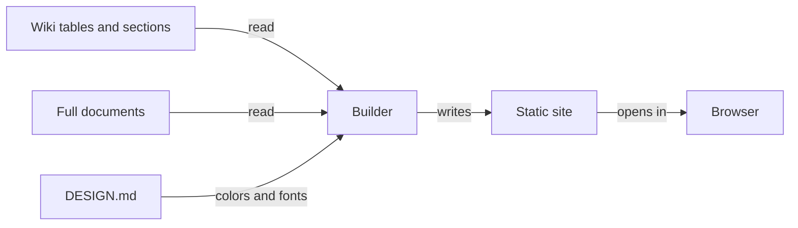

# s0002 - Build the web knowledge explorer

## Problem

### Goal

The AIDDbot knowledge lives in Markdown files: the wiki, the root documents, and the specs. GitHub and Obsidian show them as separate plain pages. A person cannot see the whole method at once: the lifecycle phases, the steps of a change, the building blocks, and the documents that each step makes.

This change builds a web explorer that tells the story of AIDDbot to people, as visually as possible. A map shows the whole method. Each part of the method has its own page with an animated diagram. The full documents are one click away. The explorer is documentation for people. It is not a graph viewer and not a copy of Obsidian.

It is part of the Foundation phase: it makes the project knowledge easy to understand before we design the skills and templates. [Lifecycle phases](../../wiki/intent.md#lifecycle-phases)

### Out of scope

- Publication to a public host, such as GitHub Pages.
- Search, editing, comments, and authentication.
- A graph of all the documents and their links.
- Reuse for the wiki of other projects, and any change to [what ships](../../wiki/scaffolding.md#what-ships). A later spec can do it.
- Validation of documents. The `doc validate` command of H3 does it. The explorer only shows the problems that it finds while it reads.
- Links to files outside the content scope, such as `LICENSE`, on a Git host. The repository has no remote yet.

### User stories

- `US1` - As a person who learns AIDDbot, I want one visual map of the whole method, so that I see how its phases, steps, building blocks, and documents fit together.
- `US2` - As a person who studies one part of AIDDbot, I want a page for that part with an animated diagram and its details, so that I understand it without reading the whole wiki.
- `US3` - As a person who wants all the details, I want to read the full documents rendered with their metadata and working links, so that I go deeper from any page.

## Solution

### How it works

The explorer has two parts: a **builder** that reads the documents, and a **site** that shows them in the browser.



Text equivalent: the builder reads the wiki tables and sections, the full documents, and `DESIGN.md`. It writes a static site. A person opens the site in a browser.

1. **The builder** runs on the person's machine with Bun. It reads four chapter tables from the wiki, the wiki sections and glossary terms that their rows link to, and every document of the content scope with its `META`. It writes one data file and copies the site files next to it. It stops with a clear error when the wiki breaks the contract below. It lists each smaller problem: a missing `META`, an invalid `META`, or a broken link.
2. **The site** is a set of HTML, CSS, and JavaScript files. It works on any static file server, also in a subfolder, because all its paths are relative and the views use hash addresses, such as `#/phase/design`. It loads the data file and shows the view that the address asks for.

The wiki stays the single source of truth. The site adds only layout and animation. It never edits a document.

### Chapters

The explorer tells AIDDbot in four chapters. Each chapter comes from one table of the wiki. Each row of the table is one **element** of the method.

| Chapter | Element | Source table | Columns |
| --- | --- | --- | --- |
| Lifecycle phases | Phase | [`intent.md#lifecycle-phases`](../../wiki/intent.md#lifecycle-phases) | `#`, `Phase`, `AIDDbot helps teams to`, `Project level`, `Change level` (as today) |
| Change flow | Step | [`documentation-catalog.md#change-flow`](../../wiki/documentation-catalog.md#change-flow) | `#`, `Step`, `Work`, `Uses`, `Produces` (new table) |
| Building blocks | Block | [`intent.md#building-blocks`](../../wiki/intent.md#building-blocks) | `Block`, `Role`, and a new column with the phases or documents that the block touches |
| Documents | Document type | [`documentation-catalog.md#document-catalog`](../../wiki/documentation-catalog.md#document-catalog) | `ID`, `Document`, `Life`, `Relevance`, `Standards`, `Purpose` (as today) |

### Wiki contract

The builder and the wiki agree on a small contract:

- **Location.** The builder finds each chapter by its fixed anchor, and reads the first table under it. The column names are fixed.
- **Links between elements.** A document ID in backticks, such as `` `spec` ``, links to that document type. A step with the same name as a phase links to that phase.
- **Errors.** A missing anchor, a renamed column, or an unknown document ID stops the build. The error names the file and the problem.
- **Rule for editors.** The page rules of [knowledge-wiki.md](../../wiki/knowledge-wiki.md#page-rules) say that these anchors and columns are stable. A change to them needs an explorer update. The details are in `explorer-development.md`.

To meet the contract, the wiki changes in four places:

| Page | Change |
| --- | --- |
| `documentation-catalog.md` | The change flow becomes a table with `Uses` and `Produces`. |
| `documentation-catalog.md` | "Status use" becomes a table: `Status`, `Meaning`, `Set in step`, and a column that says which document types use it. `Life` is not enough, because `adr` is `LIVE` with its own cycle. |
| `intent.md` | The building blocks table adds Templates and Wiki, and the new column. "Project knowledge" keeps its detail sections, and the rows link to them. |
| `knowledge-wiki.md` | The page rules add the contract rule. |

### Views

| View | Address | User story | Content |
| --- | --- | --- | --- |
| Map | `#/` | `US1` | The home view. One picture in layers, described below. |
| Element page | `#/<kind>/<id>` | `US2` | The row as a summary, the animated diagram of its kind, the wiki sections and glossary terms that the row links to, and the mini-map. A document type page also lists the documents of the content scope of that type. |
| Full document | `#/doc/<id>` | `US3` | The rendered Markdown, the `META` fields as badges, a table of contents, and the `related` documents and `sources` as links. |
| Not found | any other | `US1` | A message and a link to the map. |

### The map

The map is one picture in layers:

```text
        ┌──────── Maintenance ◄── Release ◄──┐
        │                                     │
        ▼     ┌─── change flow ──────────┐    │
  Foundation ─► Analysis ► Design ► Impl ► Verif ► Close
   [glossary]   [spec]     [adr]           [review-report]

 ════════════════════════════════════════════════════
  Skills · Templates · Scripts · Wiki · Distribution
```

- The phase loop is in the middle. The change flow sits inside the change-level phases. The document types hang under the phase or step that names them. The building blocks form a band below.
- Code places each element by rules, from the table order. Nobody draws the map by hand. A new table row appears on the map with no drawing work.
- A click on an element zooms the map into it, and then opens its page.
- The same picture, small, is the mini-map of each page. It marks the current element. A click on the mini-map goes back to the map.

### Page diagrams

Each element kind has one diagram template. The builder fills it from the tables, so a new row gets its diagram with no drawing work. The diagram builds up step by step when the page opens.

```text
PHASE  (Design)
  Analysis ──► [ Design ] ──► Implementation
                  │
       project: adr, design-system
       change:  tasks / impl-plan

STEP   (Verification)
  spec ──► [ Verification ] ──► ticked spec
                  └── fails? ─► review-report

BLOCK  (Skills)
  [ Skills ] ── uses ──► Templates, Scripts
      └── runs in ──► Analysis … Close

DOCUMENT  (spec)
  draft ──► accepted ──► done
   Analysis   Design      Close
```

### Content

| Group | Files | Shown as |
| --- | --- | --- |
| Wiki | `docs/wiki/*.md` | Chapter tables, linked sections, and full documents |
| Root | `README.md`, `AGENTS.md`, `PLAN.md`, `DESIGN.md`, `CHANGELOG.md` | Full documents |
| Specs | `docs/specs/*.md` | Full documents |

Rules for `META`:

- Wiki pages and specs must have `META`. If it is missing or invalid, the document shows a warning.
- `README.md`, `AGENTS.md`, and `CHANGELOG.md` have no `META` by design. They show no warning. The builder gives them their document type from the file name: `readme`, `agent-instructions`, and `changelog`.
- `DESIGN.md` keeps its `META` under the `aiddbot` key of its frontmatter, as the [DESIGN.md format](https://github.com/google-labs-code/design.md/blob/0.4.0/docs/spec.md) asks.
- A link to a file outside the content scope, such as `LICENSE`, shows as plain text with a small "outside the explorer" mark.

### Building blocks

- **Web Components.** Each part of the screen is one custom element in its own file, such as `<aidd-map>`, `<element-page>`, or `<doc-view>`. A component can be reused in any view. There is no UI framework.
- **Visual identity.** The colors of [DESIGN.md](../../../DESIGN.md) become CSS variables. The dark theme is the default. A button switches to the light theme. The three fonts come from `@fontsource` packages and ship with the site.
- **Animations.** The map, the page diagrams, and the zoom are hand-written SVG and CSS, with the Web Animations API. When the browser asks for reduced motion, every diagram shows its final state at once, and a click opens the page with no zoom.
- **Libraries.** Only two:
  - The builder parses Markdown with the built-in `Bun.markdown`. It adds heading ids as GitHub slugs, because `Bun.markdown` does not.
  - The `mermaid` package renders the Mermaid blocks of a full document, with the colors of `DESIGN.md`. The site loads it only when such a document opens. The map and the element pages never load it.
  - Each library is pinned in `package.json`.
- **Language and checks.** TypeScript on Bun, as in [CLI development](../../wiki/cli-development.md). `bun lint`, `bunx tsc --noEmit`, and `bun test` run on the explorer code.

### Repository changes

- Code in `packages/explorer/`, the first package of the repository. The build output is ignored by Git.
- Root `package.json` scripts: `explorer:dev` (a local server that rebuilds on change) and `explorer:build`.
- The four wiki changes of the [wiki contract](#wiki-contract).
- A new Development wiki page, `explorer-development.md`: commands, folders, the wiki contract in detail, and the component rules. `index.md` lists it.
- Updates to `scaffolding.md`, `AGENTS.md` (the checks apply to the explorer code), `PLAN.md`, the glossary (term **knowledge explorer**), and `CHANGELOG.md`.

### Tasks

- [x] Change the wiki tables and add the contract rule, as the [wiki contract](#wiki-contract) says. Check: no broken link.
- [x] Create `packages/explorer/` with its `package.json`, TypeScript settings, and the root scripts. Check: `bun run explorer:build` runs.
- [x] Write the reader: chapter tables, links between elements, linked sections, documents, and `META`, with unit tests. Check: `bun test`, and `US1R4` with a broken copy of the wiki.
- [x] Write the site shell, the router, the theme, and the not-found view. Check: `US1R1`, and an unknown address shows the not-found view.
- [x] Write the map. Check: `US1R2`, `US1R3`.
- [x] Write the element pages and the four diagram templates. Check: `US2R1`.
- [x] Write the full document view. Check: `US3R1`, `US3R2`.
- [x] Apply the visual identity and the reduced motion rule. Check: `US2R2`, `US2R3`.
- [x] Update the documents of "Repository changes". Check: no broken link.
- [x] Check each requirement and tick it. Write the review report only if a requirement fails or there are findings.

## Verification

- [x] `US1R1` - When a person runs the build script, the explorer shall write a static site that works from a subfolder of a static file server.
- [x] `US1R2` - When a person opens the map, the explorer shall show every phase, step, building block, and document type of the chapter tables, in their table order, with the links between them.
- [x] `US1R3` - When a person clicks an element on the map, the explorer shall zoom into that element and then open its page.
- [x] `US1R4` - If a chapter anchor, a chapter column, or a document ID of the wiki contract is missing or unknown, then the build shall stop with an error that names the file and the problem.
- [x] `US2R1` - When a person opens an element page, the explorer shall show the row summary, the animated diagram of the element kind, the linked wiki sections and glossary terms, and the mini-map with the element marked.
- [x] `US2R2` - The explorer shall use the colors and fonts of `DESIGN.md`, with a dark and a light theme, and a text contrast of at least 4.5:1.
- [x] `US2R3` - While the browser asks for reduced motion, the explorer shall show every diagram in its final state and open pages with no zoom.
- [x] `US3R1` - When a person opens a full document, the explorer shall render its headings, tables, code blocks, and Mermaid diagrams, show its `META` fields as badges, and open each relative link to a document of the content scope at its target anchor.
- [x] `US3R2` - If a wiki page or a spec has no `META` or an invalid `META`, or a document has a broken relative link, then the explorer shall show the document with a warning, and the build shall list each problem with its file.
