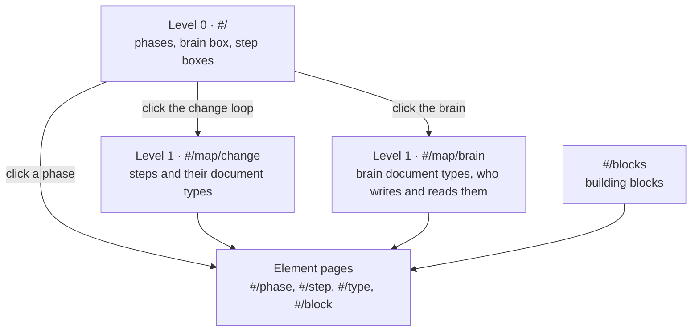

# s0005 - Give the explorer maps in layers

## Problem

### Goal

The explorer map shows everything at once: the project loop, the project brain with all its document types, the document types under each step, the links, and the building blocks band. A person who opens the explorer for the first time sees too much. The building blocks add noise and no story to the map.

This change gives the information in layers. It applies the brainstorm proposals M1 to M7 of 2026-11-26:

| # | Proposal |
| --- | --- |
| M1 | Level 0 is an overview: phases, the project brain as one box, and the steps as boxes. No document types, no building blocks. A click opens a map with more detail. Element pages are the last level. |
| M2 | The building blocks leave the maps. They get the view `#/blocks`, with a link in the header. |
| M3 | The project brain has its own map. |
| M4 | The change loop has one map, with a filter of impact level. |
| M5 | The impact levels table gets the columns `Skips` and `Adds`. The wiki contract has seven tables. |
| M6 | Each map has an address. Each element has one parent map. The breadcrumbs show the full path. |
| M7 | The mini-map draws the parent map of the element. |

### Out of scope

- New content for the element pages and their diagrams.
- An impact filter on the overview or the brain map.
- Changes to the building blocks table of the intent page.
- A map with more detail for a phase.

### User stories

- `US1` - As a person who learns AIDDbot, I want a short overview first and the building blocks apart, so that the first view does not overload me.
- `US2` - As a person who learns AIDDbot, I want a detail map of the change loop and of the project brain, and a filter by impact level, so that I see the documents only when I ask for them.
- `US3` - As a person who explores AIDDbot, I want breadcrumbs and a mini-map that show the map of each element, so that I always know where I am and how to go back.

## Solution

### Levels



Text equivalent: the overview at `#/` opens the change loop map, the brain map, and the phase pages. The two detail maps open the step and document type pages. The blocks view at `#/blocks` opens the block pages.

### Parent map

Each element has one parent map. The breadcrumbs and the mini-map use it.

| Element | Parent map | Breadcrumbs |
| --- | --- | --- |
| Phase | Overview `#/` | Map › Foundation |
| Step | Change loop `#/map/change` | Map › Change loop › Design |
| Document type of the brain | Brain `#/map/brain` | Map › Project brain › `glossary` |
| Other document type | Change loop `#/map/change` | Map › Change loop › `spec` |
| Building block | Blocks `#/blocks` | Map › Building blocks › Skills |

### The maps

```text
LEVEL 0     Foundation ──► Development ──► Release ──► Maintenance
                               │ zoom          ▲            │
                               ▼               │  feedback  │
            ┌─ PROJECT BRAIN ──────────────────┴──┐ ◄───────┘
            └─────────────────────────────────────┘
            Analysis ► Design ► Implementation ► Verification ► Close

CHANGE      │ readme  glossary  wiki-page  agents  roadmap  adr  ... │
LOOP        Analysis ► Design ► Implementation ► Verification ► Close
            spec       ...       code             test-report
            [ small | medium | large ]

BRAIN       Foundation  Development  Release  Maintenance  (phases)
            │ readme  glossary  wiki-page  agents  roadmap  adr  ... │
            Analysis    Design   Implementation   Verification   Close
```

Map rules:

- **Overview.** It keeps the project loop row, the zoom line, and the feedback arrow of today. The brain is one box with its name and the count of its document types. The steps are boxes in a frame, with no document types under them. A link joins a phase or a step to the brain box when its `Uses` or `Produces` holds a brain document type.
- **Clicks on the overview.** A phase opens its page. The brain box opens the brain map. The change loop frame or a step opens the change loop map.
- **Change loop map.** It is the current map without the project loop row and without the blocks band. The brain band stays above the steps. The rules for document types and links stay as they are.
- **Impact filter.** The change loop map has a selector: `small`, `medium`, `large`. The default is `medium`. A level hides the document types in its `Skips` cell. It marks the document types in its `Adds` cell as required.
- **Brain map.** The brain document types form the middle row, in catalog order. The phases form the top row, and the steps the bottom row. A person who points at a document type sees the links to the phases and steps that use or produce it. A person who points at a phase or a step sees its links.
- **Blocks view.** It lists every building block in table order, with its role and a link to its page.

### Wiki changes

| Page | Change | Proposal |
| --- | --- | --- |
| `documentation-catalog.md` | The [impact levels](../../wiki/documentation-catalog.md#impact-levels) table gets the columns `Skips` and `Adds`, after `Flow`. `small` skips `feature-file`, `e2e-test`, and `test-report`. `large` adds `review-report`. `medium` holds `—` in both. | M5 |
| `explorer-development.md` | The wiki contract gets the impact levels table: seven tables. The map rules and the site rules describe the levels, the addresses, the parent map, and the blocks view. The Pending section goes away. | M1 to M7 |
| `CHANGELOG.md`, `PLAN.md` | An entry for the change. | — |

### Builder changes

- **Impact levels.** The builder reads the new table. `Skips` and `Adds` are ID columns. An unknown document ID stops the build, as in the other ID columns.
- **Parent map.** The builder gives each element its parent map, from the rules of the [parent map](#parent-map) table. No element ID is written in the code.

### Tasks

- [x] Change the impact levels table and the explorer page, as the [wiki changes](#wiki-changes) say. Check: no broken link.
- [x] Read the impact levels table in the builder and give each element its parent map, with unit tests. Check: `US2R2`, `bun test`.
- [x] Add the views `#/map/change`, `#/map/brain`, and `#/blocks`, and the header link. Check: `US1R3`, `US2R1`, `US2R3`.
- [x] Draw the overview and its clicks. Remove the blocks band from the maps. Check: `US1R1`, `US1R2`.
- [x] Add the impact filter. Check: `US2R2`.
- [x] Change the breadcrumbs and the mini-map. Check: `US3R1`, `US3R2`.
- [x] Run `bunx tsc --noEmit` and `bun test`. Check: both pass.
- [x] Update `CHANGELOG.md` and `PLAN.md`. Check: no broken link.
- [x] Check each requirement and tick it. Write the review report only if a requirement fails or there are findings.

## Verification

- [x] `US1R1` - When a person opens `#/`, the explorer shall show the phases in one row, the project brain as one box, and the steps as boxes, with no document type and no building block.
- [x] `US1R2` - When a person clicks the brain box or the change loop on the overview, the explorer shall open the brain map or the change loop map, and when the person clicks a phase, the explorer shall open its page.
- [x] `US1R3` - When a person opens `#/blocks`, the explorer shall list every building block in table order, with its role and a link to its page, and the header shall link to this view.
- [x] `US2R1` - When a person opens `#/map/change`, the explorer shall show the steps in table order, the document types under each step, and the brain band, with no phase row and no building block.
- [x] `US2R2` - When a person selects an impact level on the change loop map, the explorer shall hide the document types in its `Skips` cell and mark the document types in its `Adds` cell as required.
- [x] `US2R3` - When a person opens `#/map/brain`, the explorer shall show the brain document types in catalog order, the phases above, and the steps below, and pointing at an element shall show its links.
- [x] `US2R4` - If the impact levels table is missing, or its `Skips` or `Adds` cell holds an unknown document ID, then the build shall stop with an error that names the file and the problem.
- [x] `US3R1` - When a person opens an element page, the breadcrumbs shall show the path from the overview through the parent map to the element, and each part shall be a link.
- [x] `US3R2` - When a person opens an element page, the mini-map shall draw the parent map with the element marked, and a click on it shall open that map.
